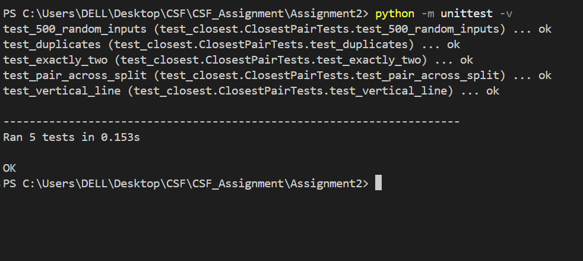
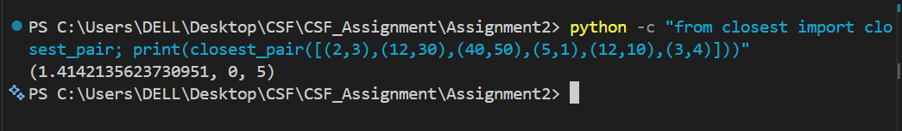
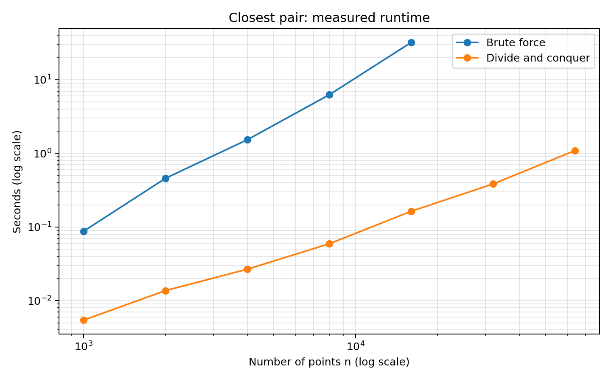

# Assignment_2
## Closest Pair of Camera Traps

### AI tool used: 
- I have used ChatGPT which helped write and revise the code

## Aim
- To use divide and conquer to determine the two closest camera traps and analyze its correctness and efficiency in comparison to brute force.

## Objectives
1. Develop the closest pair using brute force and divide and conquer methods.
2. Test these algorithms on 500 random points and the four special case edges.
3. Perform analysis of recurrence relations and comparison of running time measurements.
4. Establish the crossover point and analyze the results.

## Output and Explanation

### 1. Test results

- In Figure 1, there are 5 tests that are successful in 0.153 seconds, then ok.The random input test tests the divide-and-conquer algorithm against
brute force using 500 inputs, ranging from 2 to 50 points. The rest of the
four tests include duplicates, exactly two points, closest pair on dividing
line, and all points on vertical line. Each ok shows that the test was a success.This 0.153 seconds is the time for test suite, not big input.

### 2. Closest-pair result

- The  Figure 2 is (1.4142135623730951, 0, 5), where the first number denotes
the distance while the latter two denote the index. The traps that are close to each other are indexed 0 and 5, respectively. These two traps have the coordinates (2, 3) and (3, 4). The distance between the two traps can be found out using the formula, which yields √((3-2)2+(4-3)2)=√2≈1.414 units. The condition that 0<5 is satisfied here.

## Part C: Analysis
### 1. Recurrence and Master Method
- The brute-force algorithm compares n(n – 1)/2 pairs, so its time complexity is Θ(n²).

- Divide and Conquer algorithm sorts points according to their x and y coordinates, divides them into two parts, solves each part, and then examines the strip between the two parts.

- Assume δ is the minimum of these two distances. The strip will have
points which are within δ units away from the dividing line, making
its width 2δ. The strip is already sorted based on the y-coordinate.
The points require comparisons to a constant number of points since
the points on each side are at least δ units apart.

The recurrence is:
##### T(n) = 2T(n/2) + Θ(n), with constant time for at most three points.
#### Using the Master Method:
- a = 2: two recursive subproblems.
- b = 2: each subproblem has half the points.
- f(n) = Θ(n): work outside the recursive calls.
- n^(log₂ 2) = n, which matches f(n).
##### For case 2, T(n) = Θ(n log n). The first sorting is done in Θ(n log n).
Hence, the total time complexity is Θ(n log n).

### 2. Timing table and log-log graph
- Measurements were made using Python version 3.12.4 on Windows 11. Both algorithms were given identical random points at every size tested. Time was measured using `time.perf_counter().

- The divide and conquer timings are taken to be the median of three tries,
including sorting.For the brute force algorithm, one timing for each size was recorded, with a 60-second time limit that was strictly enforced by another process.

| Number of points (n) | Brute force (seconds) | Divide and conquer (seconds) |
|---:|---:|---:|
| 1,000 | 0.087854 | 0.005452 |
| 2,000 | 0.458836 | 0.013714 |
| 4,000 | 1.534337 | 0.026791 |
| 8,000 | 6.248823 | 0.059240 |
| 16,000 | 32.055609 | 0.163525 |
| 32,000 | Stopped at 60-second deadline | 0.384633 |
| 64,000 | Skipped after deadline | 1.090421 |

- Both axes use logarithmic scales. The brute-force line rises more steeply,
showing that its runtime grows faster. Only completed runs are plotted.

### 3. Crossover point
- The smallest measured size where divide and conquer was faster was n = 42.

| Algorithm | Time at n = 42 |
|---|---:|
| Brute force | 212.84 microseconds |
| Divide and conquer | 190.86 microseconds |

- Every integer size from 2 to 256 was checked using 20 random inputs per size.
The reported time is the median of seven batches, expressed as time per call.
Execution order alternated between batches. This crossover applies to these
measurements; timing noise can cause nearby sizes to fluctuate.

## Part D: Critical Reflection

### 1. Did measured growth match the recurrence?
- The results show the expected overall pattern: brute force grows faster than
divide and conquer. However, the measured ratios do not match the predictions
exactly. From 8,000 to 16,000 points, brute-force time increased about 5.13 times, compared with the quadratic prediction of 4. From 32,000 to 64,000 points, divide-and-conquer time increased about 2.83 times, compared with the n log n prediction of about 2.13. Memory allocation, caching and background activity may explain some of the difference. These measurements support the overall trend but do not prove the theoretical bounds.

### 3. Which edge case was hardest to get right?
- The vertical-line case required care because every point has the same x
coordinate. Splitting the y-sorted list using only x coordinates could assign
points to the wrong half. The implementation instead uses original point
indices to keep the two sorted lists consistent. The vertical-line test checks
this directly. The duplicate-point and opposite-side tests check zero distance
and the strip step. Comparing against brute force on 500 random inputs gives
additional evidence that the results are correct.

### 4. If AI was used, how was its output checked?
- An AI assistant helped write the implementation, tests and report. The code
was checked by comparing complete results against brute force on 500 random
inputs and the four required edge cases. All tests passed. Completed large
benchmark results were also compared between the two algorithms. The analysis
was checked against the implementation: it preserves y-order during recursion,
which keeps the merge step linear. The timing table contains actual measured
results rather than estimated values.
