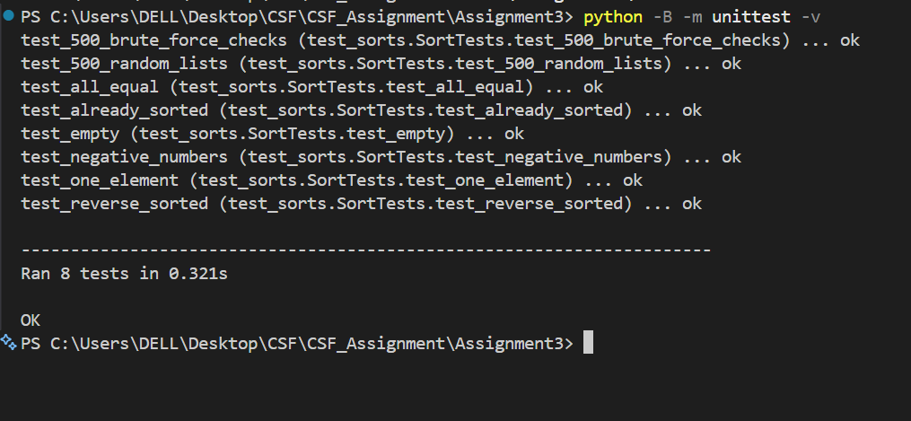
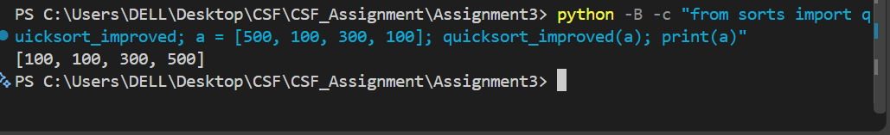
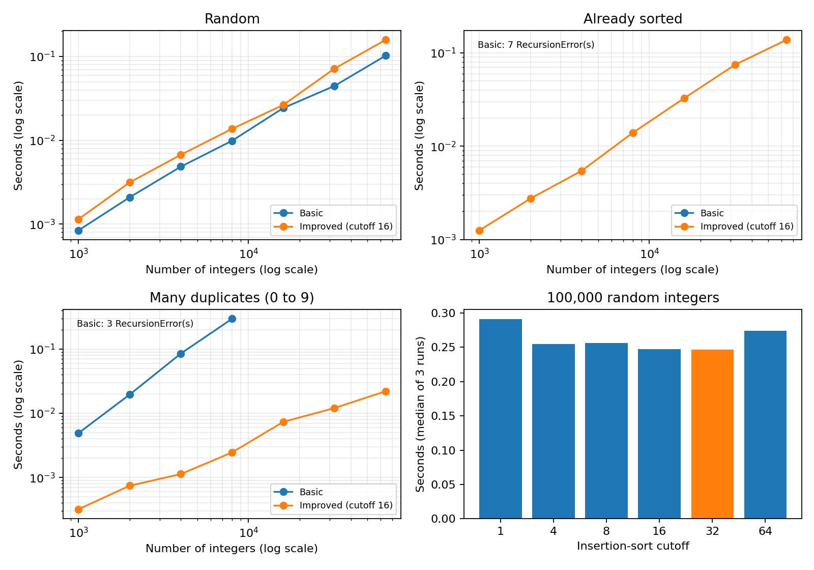

# Assignment 3: Fixing a Slow Quicksort
### AI tool used:
- ChatGPT helped write and revise the code, and also helped me to understand the question well .

## Aim
- Explain how basic quicksort fails to work on already sorted input and duplicate values, and enhance its performance with randomized pivot choice, insertion sort, and bounded recursion depth.

## Objectives
1. Implement basic quick sort with Lomuto partition scheme and the pivot at the last element.
2. Implement improved quick sort with a random pivot, cutoff for insertion sort, and recursion on the smaller part only.
3. Test both sorts against sorted(), brute force solutions, and edge cases.
4. Compare performance of the algorithms on different input (random, sorted, with duplicates),
pick the cutoff, and compare the fastest one to sorted().

## Output and Explanation
### 1. Test results

- In Figure 1, 8 tests pass in 0.321 seconds, then comes OK.
The two sorting functions are tested against sorted() using 500 random
lists and against all permutations for 500 small random lists. The 6 tests
for corner cases include all-equal elements, pre-sorted data, empty
list, negative data, 1-element list, and reverse sorted data. Each ok
signifies that the test was successful. 0.321 seconds is the time taken for
the entire test suite and not a performance benchmark of the sorting
functions for large input. The -B flag ensures that Python does not write
cache files.

### 2. Sorting an example list

- In Figure 2, the input [500, 100, 300, 100] is sorted as
[100, 100, 300, 500]. The input is sorted in an increasing order, and both
instances of 100 are retained. Since the function quicksort_improved(a)
performs sorting of the original input, the output of print(a) is shown.
Since the size of the input is less than 16, which is the default value,
the input falls within the range for the insertion sort step.

## Part C: Analysis
### 1. Timing results
- Measurements were done in Python 3.12.4 on Windows 11 using time.perf_counter(). Both algorithms were provided with the same input of each size. Random input varies from 0 to 999,999,999; highly-duplicate input varies from 0 to 9. Every value in the table is an individual run without list copying. Enhanced quicksort algorithm employs the default threshold of 16. The default recursion limit of Python – 1,000 has not been changed.

#### Random input

| n | Basic (seconds) | Improved (seconds) |
|---:|---:|---:|
| 1,000 | 0.000841 | 0.001144 |
| 2,000 | 0.002087 | 0.003142 |
| 4,000 | 0.004845 | 0.006717 |
| 8,000 | 0.009868 | 0.013683 |
| 16,000 | 0.024235 | 0.026368 |
| 32,000 | 0.044480 | 0.071510 |
| 64,000 | 0.102143 | 0.157684 |

#### Already sorted input

| n | Basic (seconds) | Improved (seconds) |
|---:|---:|---:|
| 1,000 | RecursionError | 0.001252 |
| 2,000 | RecursionError | 0.002750 |
| 4,000 | RecursionError | 0.005455 |
| 8,000 | RecursionError | 0.013955 |
| 16,000 | RecursionError | 0.032613 |
| 32,000 | RecursionError | 0.074915 |
| 64,000 | RecursionError | 0.137750 |

#### Many duplicates (values 0 to 9)

| n | Basic (seconds) | Improved (seconds) |
|---:|---:|---:|
| 1,000 | 0.004916 | 0.000320 |
| 2,000 | 0.019588 | 0.000744 |
| 4,000 | 0.085244 | 0.001132 |
| 8,000 | 0.296212 | 0.002453 |
| 16,000 | RecursionError | 0.007343 |
| 32,000 | RecursionError | 0.012055 |
| 64,000 | RecursionError | 0.021987 |

- The first three graphs use logarithmic axes. Crashed runs have no plotted
runtime. Basic quicksort was faster on the random inputs, while improved
quicksort handled sorted and duplicate-heavy inputs without crashing.

### 2. Why basic quicksort is slow
- When the input is sorted, the last element represents the maximum value.
The Lomuto partition generates segments of sizes n – 1 and 0. In each
partition, the segment is scanned in Θ(n) time, resulting in:
##### T(n) = T(n − 1) + Θ(n).
- Expansion yields Θ(n + (n − 1) + ... + 1) = Θ(n²). Recursion depth is
Θ(n) and it may surpass Python's recursion limit. Identical elements produce
imbalanced partitioning due to the fact that the basic algorithm places 
elements identical to the pivot value on the same side.

- This version selects a random pivot and splits into numbers smaller than,
equal to, and greater than the pivot. Numbers that are equal do not have to
be sorted. The algorithm uses insertion sort for small chunks. To maintain
recursion depth of O(log n), recursive calls are done on the smaller
chunk while looping through the larger chunk. Average time complexity of the
algorithm for random numbers is O(n log n) and worst case time
complexity is O(n²).

### 3. Best cutoff for 100,000 random values
- The same input was used for every cutoff. Times are medians of three runs.
Each run used a fixed pivot seed, shared across cutoff choices.

| Cutoff | Improved time (seconds) |
|---:|---:|
| 1 | 0.290928 |
| 4 | 0.255087 |
| 8 | 0.256403 |
| 16 | 0.247752 |
| 32 | 0.246744 |
| 64 | 0.274425 |

- The quickest time recorded for the cutoff is 32, which took 0.246744 seconds. It generated a result that was near cutoff 16, and so another trial may switch their places. This decision is applicable to this particular implementation and machine.

### 4. Comparison with Python's sorted()
- On the same 100,000 random values:

| Algorithm | Median time over three runs (seconds) |
|---|---:|
| Improved quicksort, cutoff 32 | 0.246744 |
| Python's sorted() | 0.015586 |

- sorted() was approximately 15.8 times faster. Its timing includes
creating the output list. Improved quicksort modifies its input in place;
sorted() returns a new list.

## Part D: Critical Reflection
### 1. Why did basic quicksort fail on sorted data?
- The timing tables record RecursionError on sorted inputs. Choosing the last
element selected the largest value each time, leaving almost the entire list
for the next recursive call. This caused quadratic work and linear recursion
depth. Average-case analysis assumes pivot ranks are reasonably distributed,
as with random input or random pivots. Sorted real data broke that assumption
for a fixed last-element pivot. The improved version completed every measured
sorted input because its smaller-part recursion bounds stack depth.

### 2. Why use quadratic insertion sort for small parts?
- Insertion sort avoids the pivot selection, partitioning and recursive-call
overhead of quicksort. On short parts, those savings can outweigh its quadratic
comparisons and shifts. In this experiment, cutoff 32 gave the lowest median
time among the six tested values. Keeping the cutoff fixed limits the size of
each insertion-sort task, preserving expected O(n log n) total time. The fastest
cutoff can change with the machine and implementation.

### 3. Why was sorted() faster?
- Python's `sorted()` was about 15.8 times faster on the random input. Its
adaptive merge-based sorting implementation is highly optimized and can
exploit existing ordered runs. Its core operations execute in compiled code,
while this quicksort repeatedly executes Python-level loops, comparisons and
swaps. Both have O(n log n) expected time on random data, so asymptotic order
alone does not explain the difference. These measurements cannot separate
algorithm effects from language effects; that would require controlled
implementations of both algorithms in the same language.
