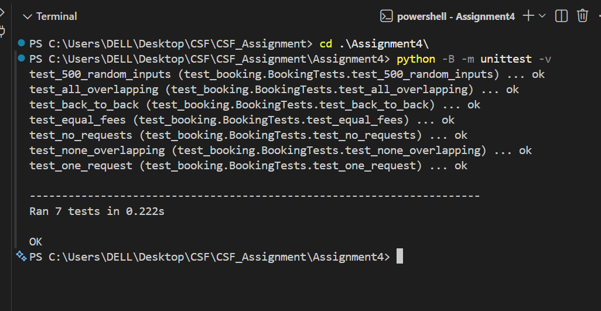

# Assignment 4: Booking the Hall
### AI tool used:
- ChatGPT helped write and revise the code, and also helped me to understand the question well .

## Aim
To find the optimal allocation of hall bookings that gives the maximum total income as well as to compare dynamic programming with two other greedy algorithms.

## Objectives
1. Implement greedy algorithms for earliest finish and maximum fee.
2. Implement dynamic programming algorithm with predecessor checking and schedule generation.
3. Test DP using brute-force approach on 500 random inputs and required corner cases,
   test earliest finish when fees are equal.
4. Generate counter-examples for both greedy approaches, calculate ratio of revenues,
   derive recurrence and complexity for the algorithms.

## Output and Explanation

- Figure 1 below depicts 7 tests being passed in 0.222 seconds, then there is an OK. The OK signifies the following:
1. 500 randomly generated inputs: The revenue of DP is consistent
  with the optimum obtained by brute force for input values ranging from 0 to
  10 requests. The resulting schedules are checked for validity regarding
  compatibility and indices with correct total fees. Greedy revenue cannot be
  greater than the optimum.
2. Overlapping: the test ensures that the algorithms provide the required
  revenue value for the given example of overlapping.
3. Back-to-back: a request can be started right after finishing the previous one.
4. Same fee: earliest finish provides the same revenue as brute force
  optimum on 500 randomly generated inputs with equal fees.
5. No requests: the answer consists of zero revenue and no accepted bookings.
6. None overlapping: all bookings can be accepted with the sum of their fees.
7. One request: the only booking with positive fee is accepted.

- This 0.222 seconds is for the runtime of the whole test suite, and not the
1,000 input revenue ratio test. The passing of these tests is an indication
of correctness of implementation; it does not imply optimality of either of therules for arbitrary unequal fees. The counterexamples are provided in part C. The -B flag stops python from creating bytecode cache files.

## Part C: Analysis
### 1. Counterexamples to the greedy rules
- The numbers below correspond to the original order of requests. Requests are formatted as follows: [start, end, cost].
**Earliest finish:** [(0, 2, 2), (1, 3, 10)]
| Method | Chosen indices | Total fee |
|---|---|---:|
| Earliest finish | [0] | 2 |
| Optimal DP | [1] | 10 |

- Request 0 comes first, so the greedy algorithm accepts Request 0 and rejects Request 1. Being completed early is no guarantee for maximum profit: here it results in missing a far bigger pay-off.

**Highest fee:** [(0, 4, 9), (0, 2, 5), (2, 4, 5)]
| Method | Chosen indices | Total fee |
|---|---|---:|
| Highest fee | [0] | 9 |
| Optimal DP | [1, 2] | 10 |

- The highest individual fee belongs to request 0, but it blocks two compatible requests whose combined fees are larger. Requests 1 and 2 fit back-to-back.

### 2. Why the DP recurrence is correct
- Arrange requests based on their finishing times. For every j, let p(j) be the latest request before j such that its finish time is not greater than that of j. Otherwise, set p(j) to -1. Let OPT(j) be the maximum profit obtained from requests 0 to j, and OPT(-1) = 0.

#### An optimal schedule has two possibilities:
1. It excludes request j. Its best revenue is OPT(j − 1).
2. It includes request j. Earlier chosen requests must finish by j's start,
   so its best revenue is fee_j + OPT(p(j)).
##### Therefore:
- OPT(j) = max(OPT(j − 1), fee_j + OPT(p(j)))

- The earlier schedule in either case must itself be optimal. Otherwise,
replacing it with a better compatible schedule would improve the whole
solution. This is optimal substructure. Taking the maximum covers both
possibilities, so the recurrence finds the optimum.

- The implementation finds predecessors with binary search. It reconstructs
the schedule by walking backward through the DP table: include a request
when its inclusion improves the total, then jump to its predecessor;
otherwise skip it. Returned indices refer to the original input.

### 3. Greedy revenue ratios
- The experiment used 1,000 random inputs of 50 requests, generated with
Python's random.Random(306). For each request, start was an integer from
0 to 99, duration from 1 to 20, and fee from 100 to 10,000, all sampled
uniformly. Finish was start plus duration. Both greedy rules and DP received
the same inputs. Positive fees ensure optimal revenue is nonzero.

- For each input, ratio = greedy revenue / optimal DP revenue. The average is the arithmetic mean of the 1,000 ratios. The worst ratio is the minimum observed ratio.

| Greedy rule | Average ratio | Worst ratio |
|---|---:|---:|
| Earliest finish | 0.801748 (80.17%) | 0.469565 (46.96%) |
| Highest fee | 0.871340 (87.13%) | 0.566674 (56.67%) |

- Highest fee performed better on average in this experiment, but neither
rule always maximized revenue. These observed ratios are not guaranteed
bounds for other inputs.

### 4. Time complexities

| Function | Time complexity | Reason |
|---|---|---|
| `greedy_earliest_finish` | O(n log n) | Sort by finish, then scan once. |
| `greedy_highest_fee` | O(n²) | Sort by fee, then check each candidate against accepted requests. |
| `best_schedule` | O(n log n) | Sort and binary-search predecessors; DP and reconstruction are linear. |
| `brute_force` | O(n · 2ⁿ) | Examine all 2ⁿ subsets, scanning up to n requests per subset. |

### Equal-fee case and test results
- When all fees are equal and nonnegative, maximizing revenue is equivalent
to maximizing the number of bookings. Earliest finish achieves this: replace
the first event of any maximum-count schedule with the earliest-finishing
event. It finishes no later, leaving room for every later event. Repeating
this argument proves the greedy rule is optimal.

- All 7 tests passed, including 500 random inputs of 0 to 10 requests
comparing DP with brute force, the five required edge cases, and 500 random
equal-fee inputs. Tests also verify chosen-index uniqueness, compatibility
and total fees. Different optimal schedules may have different indices,
so comparisons check revenue and schedule validity.

## Part D: Critical Reflection
### 1. What do counterexamples say about testing correctness?
- Testing is useful for providing evidence but will not be able to prove
the correctness of the algorithm for all input. The earliest-finish test rule
scored only 2 rather than 10 for the two-request counter example. The
highest-fee test rule scored 9 instead of 10 for the three-request counter
example. One counter example is sufficient to disprove a claim of universal
optimality. Testing randomly against brute force helps find bugs in DP, whereas the recurrence explanation explains its success beyond tested inputs.

### 2. Should the manager keep the simple rule?
- In terms of maximizing profits, DP should be used by the manager. The earliest finish method gained, on average, 80.17% of the best possible profit and just 46.96% in the worst observed case. However, with the highest fee criterion, these values improved to 87.13% and 56.67%, respectively, while the algorithm still lost much revenue. DP algorithm has the same order of magnitude of computational complexity as the earliest finish, O(n log n), in this implementation. Therefore, there is no asymptotic advantage of the heuristic method.

### 3. Why does greedy work for equal fees?
- Since all accepted requests have equal fees, then maximizing revenue is maximizing the number of accepted requests. Selecting the earliest finish allows for the maximum available time while not decreasing the maximum number of events that can be accepted. The tests conducted using the equal fee of 500 agreed with the brute force approach. For unequal fees, one valuable request may be more valuable than a few low-fee ones.
